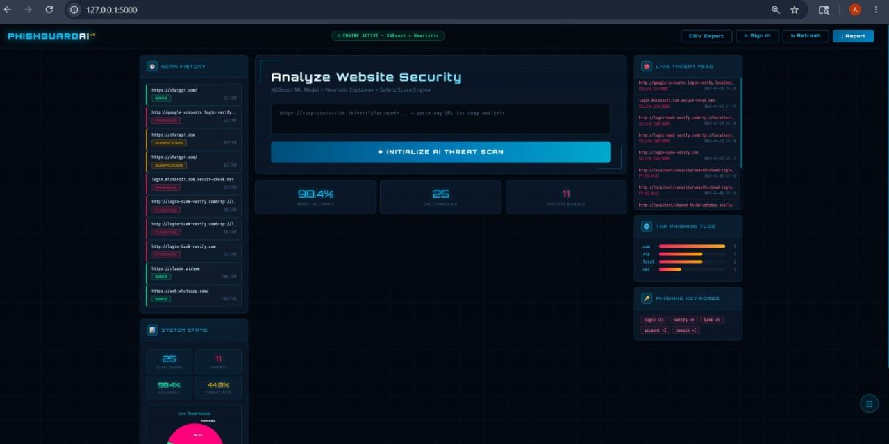

# PhishGuard

**Real-time phishing URL detection and risk analysis platform.**
Paste a URL and get a SAFE / SUSPICIOUS / PHISHING verdict, a 0-100 safety score, and plain-language red flags that explain why.

> **This is a showcase repository.** The source code lives in a private repository. This page documents what the product does, how it is designed, and what I learned building it. Happy to walk through the code or a live demo on request.

> PhishGuard is an educational security aid, not a guarantee. Verdicts can produce false positives and false negatives, so it should never be the sole safeguard against phishing.

[**Live Demo**](https://phishguard-zw3p.onrender.com/) | [**LinkedIn**](https://linkedin.com/in/ratnesh-pathak-087466279) | [**Email**](mailto:pathakratnesh03@gmail.com)

*Hosted on a free tier: the first load may take up to a minute while the app wakes up.*

---

## Preview



*Dashboard: URL scanner, scan history, live threat feed, top phishing TLDs and keywords, and system stats.*

---

## The Problem

Phishing links are designed to look legitimate, and a bare "safe / unsafe" answer from a black box does little to help people learn what to watch for. PhishGuard pairs a machine learning classifier with transparent rule-based checks, so every verdict comes with reasons a person can understand.

## What It Does

| Area | Capability |
|---|---|
| **Real-time analysis** | Submit a URL and get an instant SAFE / SUSPICIOUS / PHISHING verdict |
| **Feature extraction** | Up to 24 lexical and structural features per URL |
| **ML detection** | XGBoost classifier with a transparent heuristic fallback when no model is loaded |
| **Risk scoring** | 0-100 safety score with risk categorization |
| **Explainability** | Each flagged issue comes with a plain-language explanation and a tip on why it matters |
| **Analytics dashboard** | Threat distribution chart, scan history, live threat feed, top phishing TLDs and keywords |
| **Bulk and export** | Bulk URL scanning, CSV export of scan history, PDF security audit report |
| **Accounts and admin** | User sign-up and login, plus an admin view for managing recorded scans |

## How It Works

```
URL input
  -> Sanitization and validation
  -> Feature extraction (24 features)
  -> ML prediction (XGBoost), or heuristic red-flag scoring as fallback
  -> Safety score and risk category
  -> Verdict + explainable flags + updated analytics
```

Signals it looks at: URL length, suspicious TLDs, brand-impersonation patterns, punycode / IDN homographs, entropy-based randomness, and (optionally) domain age from WHOIS data.

## Tech Stack

- **Backend:** Python, Flask, SQLite
- **ML / data:** XGBoost, scikit-learn, pandas, NumPy
- **Visualization and reports:** Matplotlib, fpdf2
- **Frontend:** HTML, CSS, JavaScript (server-rendered templates)

## Model Notes (Honest Version)

- **Dataset:** public "Phishing Site URLs" dataset from Kaggle, cleaned to about 507,000 unique URLs (roughly 393,000 safe and 114,000 phishing)
- **Training:** 24 features, 5-fold cross-validation, class-imbalance handling

| Metric | Result |
|---|---|
| 5-fold CV accuracy | 87.9% |
| ROC-AUC | 0.947 |
| Phishing class: precision / recall / F1 | 0.68 / 0.84 / 0.75 |
| Safe class: precision / recall / F1 | 0.95 / 0.89 / 0.92 |

- **Known limitation, found by manual testing:** the model sometimes flags well-known legitimate domains as phishing. The dataset's "safe" URLs are structurally simpler than its "bad" ones, and the model over-relies on that difference. The rule-based layer and explainable flags stay useful independently of the model.
- **Next step:** retrain on a more diverse, balanced dataset and add well-known safe domains to the training data before treating the model as production-ready.

## Engineering Highlights

- Graceful degradation: the app stays fully functional with the heuristic scorer when no trained model is present
- Explainability built in, so every verdict can be inspected instead of trusted blindly
- Full workflow beyond the model: auth, admin tools, analytics, bulk scanning and report export
- Honest evaluation: limitations are documented rather than hidden

## Roadmap

- [ ] Retrain on a more diverse, balanced dataset
- [ ] Add well-known safe domains to the training data

## Author

**Ratnesh Pathak** - M.Sc. Information Technology, AI / ML Engineer, Founder of Team Ignites

GitHub: [@RatneshPathak](https://github.com/RatneshPathak) | LinkedIn: [Ratnesh Pathak](https://linkedin.com/in/ratnesh-pathak-087466279) | Email: pathakratnesh03@gmail.com

---

(c) Ratnesh Pathak. All rights reserved. The text and images in this repository may not be reused without permission.
